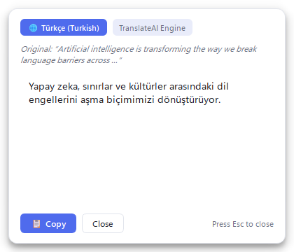

# 🌐 TranslateAI

### **No Barrier, No Border**

*Asistente moderno de traducción por IA, OCR y escritura para Windows 10 y 11.*

---

**[English](../README.md) • [Türkçe](README.tr.md) • [Español](README.es.md) • [Français](README.fr.md) • [Deutsch](README.de.md) • [Русский](README.ru.md) • [العربية](README.ar.md) • [עברית](README.he.md) • [简体中文](README.zh.md) • [日本語](README.ja.md) • [한국어](README.ko.md)**

---

## 🌟 Resumen

**TranslateAI** es una herramienta de escritorio para Windows que integra traducción inteligente, captura OCR de pantalla, modelos locales `.gguf` sin conexión y mejora de redacción en todo tu sistema operativo.

Ya sea redactando correos en Outlook, chateando en Discord/Slack, programando en VS Code o leyendo artículos en el navegador, TranslateAI funciona al instante mediante cómodos atajos globales.

> **«No Barrier, No Border»** — Comunícate libremente en cualquier idioma, en cualquier lugar de tu escritorio, con total privacidad.

---

## 🆕 Novedades de la versión v1.0.1

- **🧠 Motor integrado TranslateAI Engine (`.gguf`):** Crea automáticamente una carpeta `models/` junto a la aplicación y ejecuta modelos `.gguf` preinstalados 100 % sin conexión.
- **🔌 Proveedor OpenAI Compatible:** Proveedor local unificado bajo el nombre **OpenAI Compatible** y pestañas modernas sin flechas de desplazamiento ni saltos de tamaño.
- **🇮🇱 Interfaz en hebreo y soporte RTL (`עברית`):** Traducción completa de la interfaz al hebreo con diseño nativo de derecha a izquierda (RTL), sumando 11 idiomas de interfaz.
- **🎨 Mejoras visuales y de usabilidad:** Marcas de verificación vectoriales nítidas, nombres nativos limpios en los selectores de idioma y notas descriptivas debajo de cada atajo de teclado.
- **🏷️ Renombrado oficial a TranslateAI:** Marca unificada y ejecutable actualizado a `TranslateAI.exe`.

---

## 📥 Descarga e Inicio Rápido

No necesitas Python, consola ni configuraciones complicadas:

1. Visita la sección **[Releases (Versiones)](https://github.com/eYushaa/AI-Translator/releases)** en GitHub.
2. Descarga **`TranslateAI-Setup.exe`** y ejecuta el instalador.
3. Selecciona el modelo de IA que desees durante la instalación y completa la descarga.
4. ¡Listo, aquí tienes **TranslateAI** en la **bandeja del sistema** de Windows preparado para usar!

---

## ✨ Características Principales

### 🚀 1. Atajos Globales y Reemplazo Directo
- **`Alt + B` — Traducir en el lugar:** Selecciona cualquier texto y presiona `Alt + B`. El texto se sustituye al instante por su traducción.
- **`Alt + N` — Ventana emergente flotante:** Muestra la traducción en un recuadro emergente junto al cursor sin modificar el texto original.
- **`Alt + O` — Captura de pantalla y OCR:** Recorta cualquier área de la pantalla; el texto se reconoce y traduce de inmediato.
- **`Alt + M` — Selector rápido de idioma:** Cambia el idioma de destino al instante con una barra de búsqueda rápida.
- **`Alt + V` — Pulir y mejorar fluidez:** Reescribe el texto seleccionado para que suene más profesional y fluido en su mismo idioma.
- **`Alt + C` — Corrector ortográfico y gramatical:** Corrige errores tipográficos y de gramática en un solo clic.

---

### 📸 2. Motor OCR Dual (Windows Nativo e IA Vision)
- **Rápido y sin conexión:** Utiliza `Windows.Media.Ocr` nativo para reconocimiento inmediato sin consumir internet.
- **Respaldo con IA Vision:** Si el texto no es legible o tiene tipografías complejas, utiliza automáticamente **Google Gemini Vision**.
- **Herramienta de recorte:** Pantalla atenuada con cruz de selección; cancelación rápida con Escape o clic derecho.

---

### 🤖 3. Múltiples Proveedores de IA y Motor GGUF Integrado
- **TranslateAI Engine (`.gguf` integrado):** Ejecuta modelos `.gguf` desde la carpeta `models/` 100 % sin conexión y sin servidores externos.
- **OpenAI Compatible (Ollama / LocalAI / vLLM):** 100 % privado y sin conexión mediante API compatible con OpenAI (`http://localhost:11434/v1`).
- **LM Studio:** Integración directa con modelos locales (`http://localhost:1234/v1`).
- **Google Gemini:** Traducciones en la nube con Gemini 3.8 Flash, Gemini 3.5 Flash-Lite o Gemini 4 (Argon / Hydrogen / Carbon).
- **Google Translate:** Listo para usar sin necesidad de clave API.

---

## 📸 Capturas de pantalla

| Idiomas y Prompts personalizados | Ajustes de OCR y Captura |
|:---:|:---:|
|  |  |

| Proveedores de IA y Modelos | Atajos en todo el sistema |
|:---:|:---:|
|  |  |

| Selector rápido de idioma (Alt+M) | Ventana emergente de traducción (Alt+N) |
|:---:|:---:|
|  |  |

| Ajustes generales y Barra de idioma | Privacidad e Historial |
|:---:|:---:|
|  |  |

---

## ⌨️ Atajos de Teclado

| Atajo | Acción | Descripción |
|:---|:---|:---|
| <kbd>Alt</kbd> + <kbd>B</kbd> | **Traducir en el lugar** | Reemplaza el texto seleccionado directamente con la traducción. |
| <kbd>Alt</kbd> + <kbd>N</kbd> | **Traducir en ventana** | Muestra la traducción en un recuadro flotante. |
| <kbd>Alt</kbd> + <kbd>O</kbd> | **Captura y OCR** | Recorta un área de la pantalla para reconocer y traducir texto. |
| <kbd>Alt</kbd> + <kbd>M</kbd> | **Cambiar idioma** | Abre el menú rápido para elegir el idioma de destino. |
| <kbd>Alt</kbd> + <kbd>V</kbd> | **Pulir estilo** | Mejora la redacción y naturalidad del texto. |
| <kbd>Alt</kbd> + <kbd>C</kbd> | **Corregir gramática** | Soluciona faltas de ortografía y errores gramaticales. |

---

## 📄 Licencia

Este proyecto está bajo la licencia [MIT](../LICENSE).
