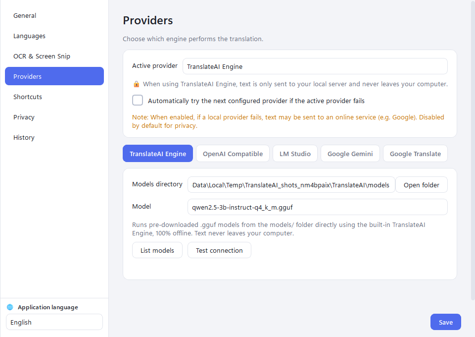
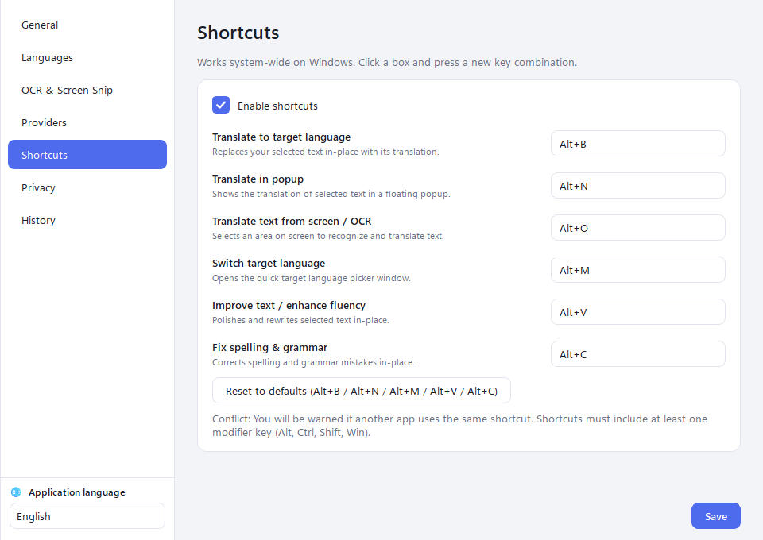

# 🌐 TranslateAI

### **No Barrier, No Border**

*Assistant moderne de traduction par IA, d'OCR et d'écriture pour Windows 10 & 11.*

---

**[English](../README.md) • [Türkçe](README.tr.md) • [Español](README.es.md) • [Français](README.fr.md) • [Deutsch](README.de.md) • [Русский](README.ru.md) • [العربية](README.ar.md) • [עברית](README.he.md) • [简体中文](README.zh.md) • [日本語](README.ja.md) • [한국어](README.ko.md)**

---

## 🌟 Présentation

**TranslateAI** est un utilitaire Windows moderne et ultra-rapide qui intègre la traduction par intelligence artificielle, la capture OCR d'écran, des modèles locaux `.gguf` hors-ligne et l'amélioration de vos écrits dans toutes vos applications favorites.

Que vous écriviez un e-mail dans Outlook, discutiez sur Slack/Discord, développiez dans VS Code ou naviguiez sur le Web, TranslateAI s'active partout grâce à des raccourcis clavier universels.

> **« No Barrier, No Border »** — Communiquez librement dans toutes les langues, partout sur votre bureau, en toute confidentialité.

---

## 🆕 Nouveautés de la v1.0.1

- **🧠 Moteur intégré TranslateAI Engine (`.gguf`) :** Crée automatiquement un dossier `models/` à côté de l'application et exécute vos modèles `.gguf` préinstallés 100 % hors-ligne.
- **🔌 Fournisseur OpenAI Compatible :** Nom unifié en **OpenAI Compatible** et onglets modernes stables sans flèches de défilement.
- **🇮🇱 Interface en hébreu & support RTL complet (`עברית`) :** Ajout complet de l'hébreu avec prise en charge native de droite à gauche (RTL), soit 11 langues d'interface.
- **🎨 Finitions visuelles et ergonomie :** Cases à cocher avec coches vectorielles nettes, noms de langues épurés sans mentions entre parenthèses et notes d'aide grises sous chaque raccourci.
- **🏷️ Identité officielle TranslateAI :** Nommage unifié et exécutable mis à jour vers `TranslateAI.exe`.

---

## 📥 Téléchargement & Démarrage Rapide

Aucune connaissance technique ni installation de Python n'est requise :

1. Rendez-vous dans la section **[Releases (Versions)](https://github.com/eYushaa/AI-Translator/releases)** sur GitHub.
2. Téléchargez **`TranslateAI-Setup.exe`** et lancez l'application d'installation.
3. Choisissez le modèle d'IA souhaité pendant l'installation et terminez le téléchargement.
4. Et voilà **TranslateAI** prêt à l'emploi dans votre **barre des tâches Windows** !

---

## ✨ Fonctionnalités Principales

### 🚀 1. Raccourcis Universels et Remplacement Direct
- **`Alt + B` — Traduction sur place :** Sélectionnez un texte et appuyez sur `Alt + B`. Le texte est immédiatement remplacé par sa traduction.
- **`Alt + N` — Fenêtre contextuelle flottante :** Affiche la traduction dans une élégante bulle près du curseur sans modifier le texte original.
- **`Alt + O` — Capture d'écran et OCR :** Sélectionnez une zone à l'écran ; le texte est instantanément reconnu et traduit.
- **`Alt + M` — Sélecteur rapide de langue :** Changez de langue cible à la volée via une barre de recherche rapide.
- **`Alt + V` — Amélioration et fluidité :** Réécrit le texte sélectionné pour le rendre plus professionnel et naturel, sans changer de langue.
- **`Alt + C` — Correction orthographique et grammaticale :** Corrige toutes les fautes de frappe et de grammaire en un clic.

---

### 📸 2. Moteur OCR Double (Windows Natif & IA Vision)
- **Rapide et Hors-ligne :** Utilise `Windows.Media.Ocr` pour une reconnaissance de texte instantanée et 100 % hors-ligne.
- **Secours IA Vision :** Si le texte n'est pas détecté, l'application bascule automatiquement sur **Google Gemini Vision**.
- **Outil de capture fluide :** Écran assombri avec mire de sélection ; annulation facile via Échap ou clic droit.

---

### 🤖 3. Modèles d'IA Multi-Fournisseurs & Moteur GGUF
- **TranslateAI Engine (`.gguf` intégré) :** Exécute les modèles `.gguf` du dossier `models/` 100 % hors-ligne sans serveur externe.
- **OpenAI Compatible (Ollama / LocalAI / vLLM) :** Confidentialité totale via API compatible OpenAI (`http://localhost:11434/v1`).
- **LM Studio :** Prise en charge directe des modèles locaux (`http://localhost:1234/v1`).
- **Google Gemini :** Traduction cloud haute fidélité via Gemini 3.8 Flash, Gemini 3.5 Flash-Lite ou Gemini 4 (Argon / Hydrogen / Carbon).
- **Google Translate :** Prêt à l'emploi sans clé API.

---

## 📸 Captures d'écran

| Langues et Prompts personnalisés | Paramètres OCR et Capture |
|:---:|:---:|
|  |  |

| Fournisseurs d'IA et Modèles | Raccourcis universels |
|:---:|:---:|
|  |  |

| Sélecteur rapide de langue (Alt+M) | Fenêtre flottante de traduction (Alt+N) |
|:---:|:---:|
|  |  |

| Paramètres généraux & Barre de langue | Confidentialité & Historique |
|:---:|:---:|
|  |  |

---

## ⌨️ Raccourcis Clavier

| Raccourci | Action | Description |
|:---|:---|:---|
| <kbd>Alt</kbd> + <kbd>B</kbd> | **Traduire sur place** | Remplace le texte sélectionné directement par sa traduction. |
| <kbd>Alt</kbd> + <kbd>N</kbd> | **Traduire dans une bulle** | Affiche la traduction dans une fenêtre flottante. |
| <kbd>Alt</kbd> + <kbd>O</kbd> | **Capture & OCR** | Découpe une zone de l'écran pour en extraire et traduire le texte. |
| <kbd>Alt</kbd> + <kbd>M</kbd> | **Changer de langue** | Ouvre le menu de recherche rapide de langue. |
| <kbd>Alt</kbd> + <kbd>V</kbd> | **Perfectionner le style** | Améliore la fluidité et le vocabulaire du texte. |
| <kbd>Alt</kbd> + <kbd>C</kbd> | **Corriger la grammaire** | Corrige les fautes d'orthographe et de grammaire. |

---

## 📄 Licence

Ce projet est sous licence [MIT](../LICENSE).
