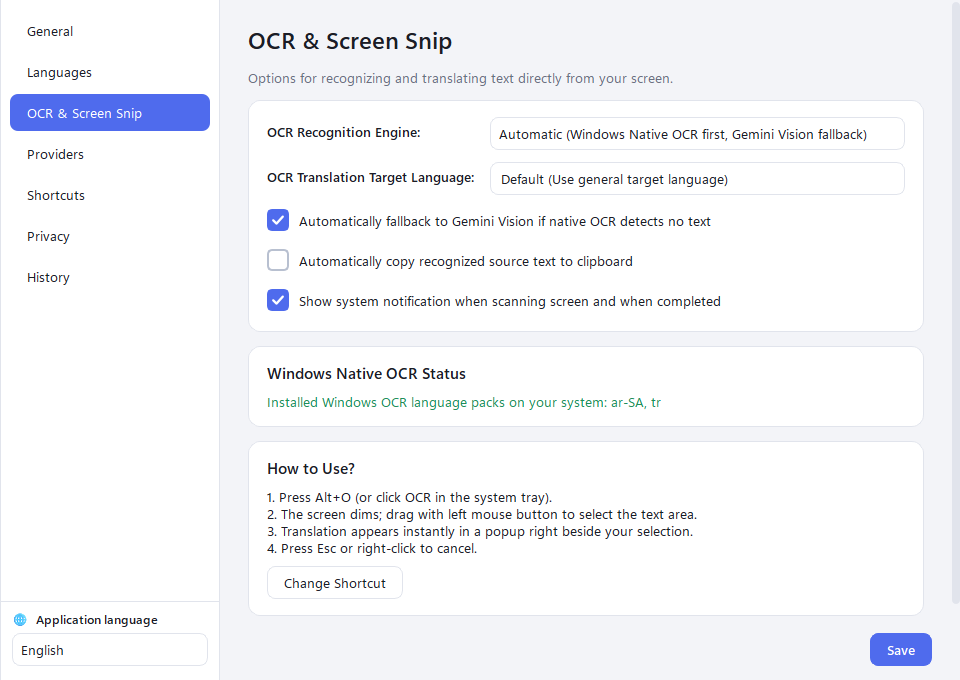
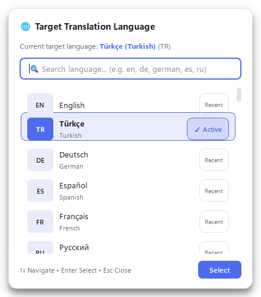

# 🌐 TranslateAI

### **No Barrier, No Border**

*עוזר מודרני לתרגום מבוסס בינה מלאכותית, זיהוי טקסט מהמסך (OCR) ושיפור כתיבה בכל רחבי Windows 10 ו-11.*

---

**[English](../README.md) • [Türkçe](README.tr.md) • [Español](README.es.md) • [Français](README.fr.md) • [Deutsch](README.de.md) • [Русский](README.ru.md) • [العربية](README.ar.md) • [עברית](README.he.md) • [简体中文](README.zh.md) • [日本語](README.ja.md) • [한국어](README.ko.md)**

---

## 🌟 סקירה כללית

**TranslateAI** הוא כלי שולחן עבודה מהיר וחכם עבור Windows, המביא תרגום AI איכותי, זיהוי טקסט בלכידת מסך (OCR), הרצת מודלים מקומיים (`.gguf`) ושיפור ניסוח לכל אפליקציה במערכת ההפעלה.

בין אם אתם כותבים אימיילים ב-Outlook, מתכתבים ב-Slack או Discord, מתכנתים ב-VS Code או קוראים מאמרים בדפדפן — TranslateAI משתלב באופן טבעי באמצעות קיצורי מקשים גלובליים.

> **"No Barrier, No Border"** — תקשרו בחופשיות בכל שפה, בכל מקום על שולחן העבודה שלכם, עם פרטיות מלאה וללא מחסומים.

---

## 🆕 מה חדש בגרסה v1.0.1

- **🧠 מנוע TranslateAI Engine מובנה (הרצת `.gguf`):** יוצר אוטומטית תיקיית `models/` לצד היישום ומריץ מודלים מסוג `.gguf` שהותקנו מראש בצורה מקומית לחלוטין (100% אופליין) ללא צורך בשרת חיצוני.
- **🔌 ספק OpenAI Compatible:** ממשק נקי ומאוחד לחיבור שרתים מקומיים ותואמי OpenAI לצד LM Studio, Google Gemini ו-Google Translate.
- **🇮🇱 תמיכה מלאה בעברית וכיווניות RTL:** נוספה תמיכה מלאה בממשק עברי עם יישור מימין לשמאל (RTL) אוטומטי לצד ערבית (סה"כ 11 שפות ממשק).
- **🎨 ליטוש ממשק המשתמש:** סימני וי וקטוריים חדים בתיבות הסימון, לשוניות ספקים יציבות ללא חיצי גלילה, שמות שפות נקיים ללא תוספות בסוגריים, והערות הסבר אפורות מתחת לכל קיצור מקשים.
- **🏷️ מיתוג רשמי בשם TranslateAI:** שם היישום וקובץ ההפעלה עודכנו ל-`TranslateAI`.

---

## 📥 הורדה והתחלה מהירה

אין צורך ב-Python, שורת פקודה או הגדרות מורכבות:

1. היכנסו לעמוד **[Releases](https://github.com/eYushaa/AI-Translator/releases)** ב-GitHub.
2. הורידו את **`TranslateAI-Setup.exe`** והריצו את ההתקנה.
3. בחרו את מודל הבינה המלאכותית הרצוי במהלך ההתקנה והשלימו את ההורדה.
4. והנה **TranslateAI** מוכן לשימוש ב**מגש המערכת של Windows**!

---

## ✨ תכונות עיקריות

### 🚀 1. קיצורי מקשים גלובליים והחלפה במקום
- **`Alt + B` — תרגום והחלפה במקום:** סמנו כל טקסט ולחצו `Alt + B`. הטקסט שבחרתם יוחלף מיידית בתרגומו.
- **`Alt + N` — חלונית צפה:** מציג את התרגום בבועה אלגנטית ליד הסמן מבלי לשנות את הטקסט המקורי.
- **`Alt + O` — לכידת מסך ותרגום OCR:** בחרו כל אזור על המסך לזיהוי ותרגום מיידיים.
- **`Alt + M` — מחליף שפה מהיר:** החלפת שפת היעד תוך שניות באמצעות חלון חיפוש מהיר.
- **`Alt + V` — ליטוש ושיפור זרימה:** משכתב טקסט נבחר לסגנון טבעי, מקצועי וברור יותר מבלי לשנות את השפה.
- **`Alt + C` — תיקון איות ודקדוק:** מתקן שגיאות כתיב, פיסוק ודקדוק במקום.

---

### 📸 2. מנוע OCR כפול (Windows מקומי + AI Vision)
- **מהיר ואופליין:** משתמש ב-`Windows.Media.Ocr` המובנה לזיהוי מיידי ללא חיבור לאינטרנט.
- **גיבוי AI Vision:** במקרים של גופנים מורכבים או תמונות מאתגרות, עובר אוטומטית ל-**Google Gemini Vision**.
- **כלי חיתוך מסך:** מסך מוחשך עם תצוגת מידות בפיקסלים וביטול מהיר ב-Esc או לחיצה ימנית.

---

### 🤖 3. ספקי AI מגוונים ומנוע אופליין מובנה
- **TranslateAI Engine (`.gguf` מובנה):** מריץ קובצי `.gguf` מתיקיית `models/` ישירות על המכשיר ללא תלות בשרת חיצוני.
- **OpenAI Compatible (Ollama / LocalAI / vLLM):** חיבור לשרתים מקומיים בכתובת `http://localhost:11434/v1`.
- **LM Studio:** שילוב ישיר עם מודלים מקומיים (`http://localhost:1234/v1`).
- **Google Gemini:** תרגום ענן מהיר ומדויק עם דגמי Gemini 3.8 Flash, Gemini 3.5 Flash-Lite ו-Gemini 4 (Argon / Hydrogen / Carbon).
- **Google Translate:** מוכן לפעולה מיד ללא צורך במפתח API (עם תמיכה אופציונלית ב-Cloud Translation API).
- **שרשרת גיבוי אוטומטית (Fallback):** מעבר אוטומטי לספק הבא במקרה של כשל או חוסר זמינות.

---

### 🌍 4. 11 שפות ממשק ותמיכת RTL מלאה
ניתן להחליף את שפת הממשק בכל עת בתחתית סרגל הצד:
- 🇹🇷 Türkçe • 🇬🇧 English • 🇫🇷 Français • 🇩🇪 Deutsch • 🇪🇸 Español • 🇷🇺 Русский • 🇸🇦 العربية *(RTL)* • 🇮🇱 עברית *(RTL)* • 🇨🇳 简体中文 • 🇯🇵 日本語 • 🇰🇷 한국어

---

## 📸 צילומי מסך

| שפות והנחיות AI מותאמות אישית | הגדרות OCR ולכידת מסך |
|:---:|:---:|
|  |  |

| ספקי AI ומנוע TranslateAI Engine | קיצורי מקשים גלובליים |
|:---:|:---:|
|  |  |

| בורר שפה מהיר (Alt+M) | חלונית תרגום צפה (Alt+N) |
|:---:|:---:|
|  |  |

| הגדרות כלליות ובחירת שפה | פרטיות והיסטוריה |
|:---:|:---:|
|  |  |

---

## ⌨️ קיצורי מקשים

| קיצור | פעולה | תיאור |
|:---|:---|:---|
| <kbd>Alt</kbd> + <kbd>B</kbd> | **תרגום במקום** | מחליף את הטקסט המסומן בתרגומו. |
| <kbd>Alt</kbd> + <kbd>N</kbd> | **תרגום בחלונית** | מציג את התרגום בחלונית צפה. |
| <kbd>Alt</kbd> + <kbd>O</kbd> | **לכידת מסך ו-OCR** | מזהה ומתרגם טקסט מאזור נבחר במסך. |
| <kbd>Alt</kbd> + <kbd>M</kbd> | **מחליף שפה מהיר** | פותח חלון לבחירה מהירה של שפת יעד. |
| <kbd>Alt</kbd> + <kbd>V</kbd> | **שיפור טקסט וזרימה** | משכתב טקסט לשיפור הניסוח והמקצועיות. |
| <kbd>Alt</kbd> + <kbd>C</kbd> | **תיקון איות ודקדוק** | מתקן שגיאות כתיב ודקדוק במקום. |

---

## 📄 רישיון

פרויקט זה מופץ תחת [רישיון MIT](../LICENSE).

