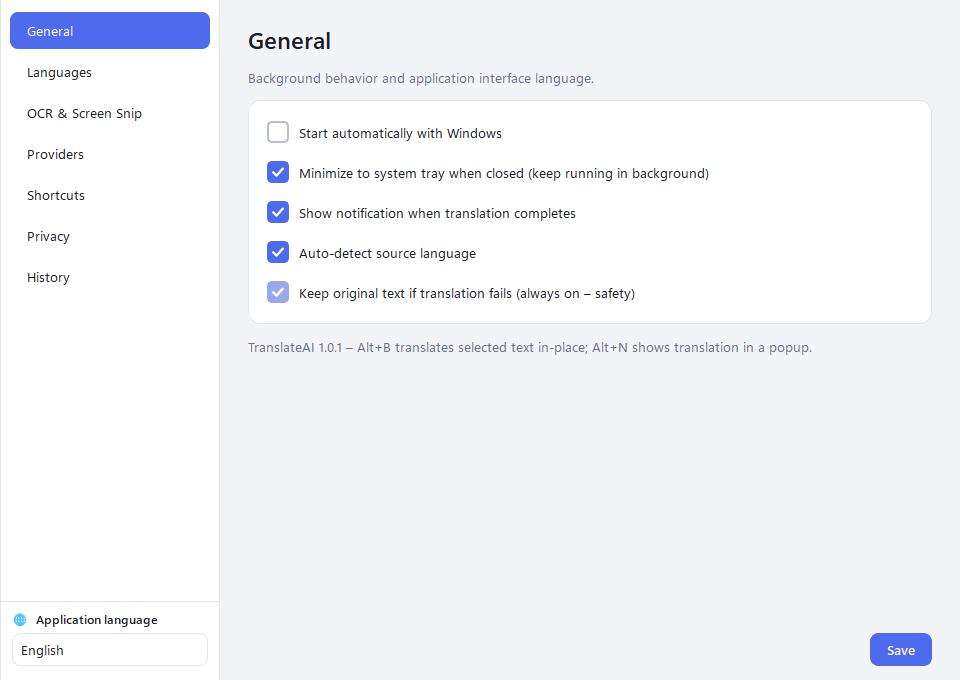

# 🌐 TranslateAI

### **No Barrier, No Border**

*Windows 10 & 11을 위한 시스템 전역 AI 번역, 화면 OCR 및 문장 다듬기 비서.*

---

**[English](../README.md) • [Türkçe](README.tr.md) • [Español](README.es.md) • [Français](README.fr.md) • [Deutsch](README.de.md) • [Русский](README.ru.md) • [العربية](README.ar.md) • [עברית](README.he.md) • [简体中文](README.zh.md) • [日本語](README.ja.md) • [한국어](README.ko.md)**

---

## 🌟 개요

**TranslateAI**는 윈도우 환경 어디서나 고품질 AI 번역, 내장 `.gguf` 오프라인 엔진, 화면 캡처 텍스트 인식(OCR), 그리고 세련된 문장 다듬기를 전역 단축키로 손쉽게 호출할 수 있는 생산성 데스크톱 유틸리티입니다.

Outlook에서 이메일을 작성하거나, Slack/Discord에서 대화할 때, VS Code에서 코딩하거나 웹 서핑 중일 때도 작업 흐름을 끊지 않고 자연스럽게 번역할 수 있습니다.

> **"No Barrier, No Border"** — 언어의 장벽과 국경을 넘어 데스크톱 위에서 완벽한 개인정보 보호와 함께 자유롭게 소통하세요.

---

## 🆕 v1.0.1 새로운 기능

- **🧠 내장 TranslateAI Engine (`.gguf` 실행 및 자동 컨텍스트 확장):** 앱 실행 폴더 옆에 `models/` 폴더를 자동 생성하고 `.gguf` 모델을 100% 오프라인 실행합니다. 긴 텍스트 번역 시 설정 가능한 상한(기본 **10K**)까지 **자동 컨텍스트 확장(`4K → 8K → 16K → 50K`)**과 **동적 컨텍스트 축소**를 지원합니다.
- **💬 문맥 인식 번역 (Context-Aware Translation):** 최근 번역 기록(기본 최근 5개 메시지, RAM에만 30분 보관)을 AI 제공자에게 참고 문맥으로 전달하여 대화 내 대명사, 고유명사, 용어 및 어조의 일관성을 유지합니다.
- **🔌 OpenAI Compatible 제공자:** 로컬 호환 제공자 이름을 **OpenAI Compatible**로 통일하고, 스크롤 화살표나 크기 흔들림이 없는 깔끔한 필(Pill) 탭 UI를 적용했습니다.
- **🇮🇱 히브리어 UI 및 RTL 완벽 지원 (`עברית`):** 아랍어에 이어 오른쪽에서 왼쪽(RTL) 레이아웃이 적용된 히브리어 UI가 추가되었습니다 (총 11개 UI 언어).
- **🎨 UI 및 사용성 개선:** 선명한 벡터 체크박스 아이콘, 괄호 설명이 제거된 깔끔한 언어 이름, 각 단축키 제목 아래 회색 안내 문구를 추가했습니다.
- **🏷️ 공식 이름 TranslateAI 변경:** 앱 브랜드, 실행 파일(`TranslateAI.exe`), 설정 경로를 **TranslateAI**로 통일했습니다.

---

## 📥 다운로드 및 빠른 시작

파이썬 설치나 복잡한 명령어 설정이 필요 없습니다:

1. GitHub의 **[Releases (릴리스)](https://github.com/eYushaa/AI-Translator/releases)** 페이지로 이동합니다.
2. **`TranslateAI-Setup.exe`**를 다운로드하여 설치 프로그램을 실행합니다.
3. 설치 과정에서 원하는 AI 모델을 선택하고 다운로드를 완료합니다.
4. 이제 **윈도우 시스템 트레이**에서 바로 **TranslateAI**를 사용할 수 있습니다!

---

## ✨ 주요 기능

### 🚀 1. 시스템 전역 단축키 & 원본 대체 번역
- **`Alt + B` — 제자리 번역 (In-Place):** 텍스트를 선택하고 `Alt + B`를 누르면 즉시 번역문으로 대체됩니다.
- **`Alt + N` — 플로팅 팝업 번역:** 원본을 변경하지 않고 커서 옆에 나타나는 깔끔한 팝업창에서 번역을 확인합니다.
- **`Alt + O` — 화면 캡처 및 OCR 번역:** 화면의 이미지, 영상, 문서 속 글자를 마우스로 드래그하여 즉시 인식하고 번역합니다.
- **`Alt + M` — 빠른 목표 언어 변경:** 중앙 검색창을 통해 목표 번역 언어를 실시간으로 손쉽게 전환합니다.
- **`Alt + V` — 문장 다듬기 & 자연스러운 표현:** 원본 언어를 유지하며 더 명확하고 전문적인 어조로 문장을 리라이팅합니다.
- **`Alt + C` — 맞춤법 및 문법 교정:** 오타와 문법 오류를 원클릭으로 수정합니다.

---

### 📸 2. 듀얼 OCR 엔진 (Windows 네이티브 & AI Vision)
- **초고속 오프라인 인식:** 인터넷 연결 없이 윈도우 내장 `Windows.Media.Ocr`을 활용하여 빠르고 정확하게 텍스트를 추출합니다.
- **AI 비전 보조:** 복잡한 폰트나 인식 불가 텍스트의 경우 자동으로 **Google Gemini Vision**으로 전환됩니다.

---

### 🤖 3. 로컬 및 클라우드 AI 모델 + 내장 GGUF 엔진 지원
- **TranslateAI Engine (내장 `.gguf`):** `models/` 폴더에 있는 `.gguf` 모델을 외부 서버 없이 100% 오프라인으로 직접 실행하며, *제공자 → TranslateAI Engine*에서 설정 가능한 최대 한도(기본 **10K**) 내 **자동 컨텍스트 확장(`4K → 8K → 16K → 50K`)** 및 **동적 컨텍스트 축소**를 제공합니다.
- **OpenAI Compatible (Ollama / LocalAI / vLLM):** OpenAI 호환 API(`http://localhost:11434/v1`)를 통해 100% 오프라인 비공개 추론.
- **LM Studio:** 로컬 모델 환경과 간편 연결(`http://localhost:1234/v1`).
- **Google Gemini:** Gemini 3.8 Flash, Gemini 3.5 Flash-Lite 및 Gemini 4(Argon / Hydrogen / Carbon)를 통한 초고속 클라우드 번역.
- **Google Translate:** API 키 없이 즉시 사용 가능한 기본 엔진 제공.

---

## 📸 스크린샷

| 언어 설정 & 사용자 지정 프롬프트 | 화면 캡처 & OCR 설정 |
|:---:|:---:|
|  |  |

| AI 제공자 및 엔드포인트 | 시스템 전역 단축키 |
|:---:|:---:|
|  |  |

| 빠른 언어 전환 HUD (Alt+M) | 플로팅 번역 팝업창 (Alt+N) |
|:---:|:---:|
|  |  |

| 일반 설정 & 인터페이스 언어 바 | 개인정보 및 기록 관리 |
|:---:|:---:|
|  |  |

---

## ⌨️ 단축키 안내

| 단축키 | 기능 | 설명 |
|:---|:---|:---|
| <kbd>Alt</kbd> + <kbd>B</kbd> | **제자리 번역** | 선택한 텍스트를 번역문으로 바로 바꿉니다. |
| <kbd>Alt</kbd> + <kbd>N</kbd> | **팝업 번역** | 원본 변경 없이 팝업창에 번역을 표시합니다. |
| <kbd>Alt</kbd> + <kbd>O</kbd> | **화면 OCR 번역** | 화면 영역을 지정하여 텍스트를 읽고 번역합니다. |
| <kbd>Alt</kbd> + <kbd>M</kbd> | **언어 변경** | 목표 번역 언어를 빠르게 변경합니다. |
| <kbd>Alt</kbd> + <kbd>V</kbd> | **문장 다듬기** | 문장의 표현을 자연스럽고 매끄럽게 교정합니다. |
| <kbd>Alt</kbd> + <kbd>C</kbd> | **문법/맞춤법 교정** | 오탈자와 문법 오류를 자동으로 바로잡습니다. |

---

## 📄 라이선스

이 프로젝트는 [MIT 라이선스](../LICENSE)를 따릅니다.
