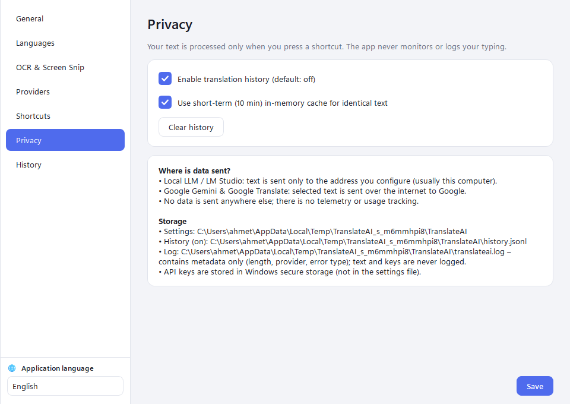

# 🌐 TranslateAI

### **No Barrier, No Border**

*Современный общесистемный ассистент для перевода через ИИ, распознавания текста (OCR) и улучшения текстов для Windows 10 и 11.*

---

**[English](../README.md) • [Türkçe](README.tr.md) • [Español](README.es.md) • [Français](README.fr.md) • [Deutsch](README.de.md) • [Русский](README.ru.md) • [العربية](README.ar.md) • [עברית](README.he.md) • [简体中文](README.zh.md) • [日本語](README.ja.md) • [한국어](README.ko.md)**

---

## 🌟 Обзор

**TranslateAI** — это быстрый и удобный системный инструмент для Windows, позволяющий мгновенно переводить тексты с помощью искусственного интеллекта, локальных офлайн-моделей `.gguf`, распознавать текст с экрана (OCR) и улучшать качество письменной речи в любых приложениях.

Пишете ли вы письмо в Outlook, общаетесь в Slack/Discord, работаете в VS Code или читаете статьи в браузере — TranslateAI всегда под рукой благодаря удобным глобальным горячим клавишам.

> **«No Barrier, No Border»** — Общайтесь без языковых барьеров и границ в любом месте рабочего стола с полной конфиденциальностью.

---

## 🆕 Что нового в v1.0.1

- **🧠 Встроенный движок TranslateAI Engine (`.gguf` и авторасширение контекста):** Автоматически создает папку `models/` рядом с приложением и запускает модели `.gguf` полностью офлайн. Поддерживает **автоматическое расширение контекста (`4K → 8K → 16K → 50K`)** до настраиваемого лимита (по умолчанию **10K**) и **динамическое сокращение контекста** для длинных текстов.
- **💬 Контекстно-зависимый перевод (Context-Aware):** Запоминает недавние переводы (по умолчанию последние 5 сообщений на 30 минут только в RAM), сохраняя единство местоимений, имён, терминов и стиля общения.
- **🔌 Провайдер OpenAI Compatible:** Локальный провайдер переименован в **OpenAI Compatible**, а вкладки провайдеров получили ровный дизайн без стрелок прокрутки и скачков ширины.
- **🇮🇱 Интерфейс на иврите и поддержка RTL (`עברית`):** Добавлена полная локализация на иврит с нативной поддержкой макета справа налево (RTL) — всего 11 языков интерфейса.
- **🎨 Обновление интерфейса:** Четкие векторные галочки в чекбоксах, чистые названия языков без пояснений в скобках и серые подсказки под названиями горячих клавиш.
- **🏷️ Официальное имя TranslateAI:** Единое брендирование и обновленный исполняемый файл `TranslateAI.exe`.

---

## 📥 Загрузка и быстрый старт

Установка Python или сложная настройка не требуются:

1. Перейдите в раздел **[Releases (Релизы)](https://github.com/eYushaa/AI-Translator/releases)** на GitHub.
2. Скачайте **`TranslateAI-Setup.exe`** и запустите установщик.
3. Выберите нужную ИИ-модель в процессе установки и дождитесь завершения загрузки.
4. И вот **TranslateAI** перед вами — программа готова к работе в **системном трее Windows**!

---

## ✨ Основные возможности

### 🚀 1. Системные горячие клавиши и замена текста
- **`Alt + B` — Перевод на месте (In-Place):** Выделите любой текст и нажмите `Alt + B`. Исходный текст мгновенно заменится своим переводом.
- **`Alt + N` — Всплывающее окно перевода:** Перевод отображается в элегантном всплывающем окне рядом с курсором, не меняя исходный текст.
- **`Alt + O` — Снимок экрана и распознавание (OCR):** Выделите любую область экрана; текст будет распознан и переведен на лету.
- **`Alt + M` — Быстрая смена целевого языка:** Мгновенный выбор нужного языка через всплывающее меню с умным поиском.
- **`Alt + V` — Улучшение стиля и беглости:** Перефразирует выделенный текст, делая его более грамотным и естественным, без смены языка.
- **`Alt + C` — Исправление грамматики и орфографии:** Мгновенно исправляет опечатки, пунктуацию и ошибки в тексте.

---

### 📸 2. Двойной движок OCR (Встроенный Windows и нейросетевой Vision)
- **Быстро и офлайн:** Использует аппаратное ускорение `Windows.Media.Ocr` для мгновенного распознавания без интернета.
- **Резервный ИИ Vision:** Если локальный OCR не находит текст, система автоматически пробует распознавание через **Google Gemini Vision**.
- **Удобный инструмент выделения:** Затемненный оверлей с индикатором размеров и быстрой отменой по Esc или правой кнопке мыши.

---

### 🤖 3. Поддержка локальных и облачных нейросетей + встроенный движок GGUF
- **TranslateAI Engine (встроенный `.gguf`):** Запускает модели `.gguf` из папки `models/` полностью офлайн прямо внутри приложения, с **авторасширением контекста (`4K → 8K → 16K → 50K`)**, настраиваемым лимитом (по умолчанию **10K** в *Провайдеры → TranslateAI Engine*) и **динамическим сокращением контекста**.
- **OpenAI Compatible (Ollama / LocalAI / vLLM):** Полная приватность и автономная работа через OpenAI-совместимый API (`http://localhost:11434/v1`).
- **LM Studio:** Прямая интеграция с локальными моделями (`http://localhost:1234/v1`).
- **Google Gemini:** Облачный перевод через новейшие модели Gemini 3.8 Flash, Gemini 3.5 Flash-Lite и Gemini 4 (Argon / Hydrogen / Carbon).
- **Google Translate:** Готов к работе без API-ключей.

---

## 📸 Скриншоты

| Языки и Пользовательские промпты | Настройки OCR и Снимка экрана |
|:---:|:---:|
|  |  |

| Провайдеры ИИ и Модели | Общесистемные горячие клавиши |
|:---:|:---:|
|  |  |

| Быстрый выбор целевого языка (Alt+M) | Всплывающее окно перевода (Alt+N) |
|:---:|:---:|
|  |  |

| Общие настройки и Панель языка | Конфиденциальность и История |
|:---:|:---:|
|  |  |

---

## ⌨️ Таблица горячих клавиш

| Сочетание клавиш | Действие | Описание |
|:---|:---|:---|
| <kbd>Alt</kbd> + <kbd>B</kbd> | **Перевод на месте** | Заменяет выделенный текст готовым переводом. |
| <kbd>Alt</kbd> + <kbd>N</kbd> | **Перевод в окне** | Показывает перевод во всплывающей подсказке. |
| <kbd>Alt</kbd> + <kbd>O</kbd> | **Снимок экрана (OCR)** | Распознает и переводит текст из выделенной области. |
| <kbd>Alt</kbd> + <kbd>M</kbd> | **Смена языка** | Открывает быстрое меню выбора языка перевода. |
| <kbd>Alt</kbd> + <kbd>V</kbd> | **Улучшение стиля** | Делает текст выразительным, живым и профессиональным. |
| <kbd>Alt</kbd> + <kbd>C</kbd> | **Исправление ошибок** | Автоматически исправляет орфографию и пунктуацию. |

---

## 📄 Лицензия

Проект распространяется под свободной лицензией [MIT](../LICENSE).
